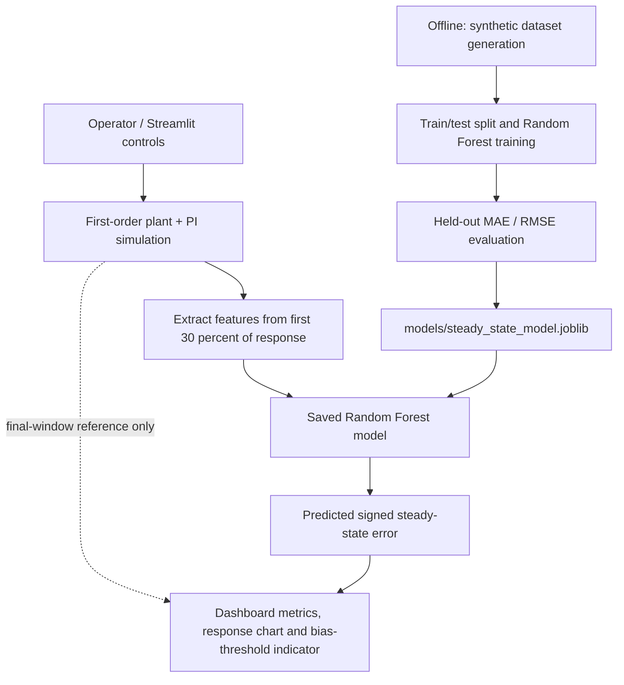

# MotionScore P04 — Project Engineering Handbook

**Closed-Loop Response Quality Predictor | Steady-State Accuracy Predictor**  
**Version:** 1.0 · **Status:** Educational proof of concept · **Interface:** Streamlit glass-prism dashboard

> **Project-specific objective:** Predict the signed residual error of a closed-loop system from its early response, then highlight cases where the predicted absolute residual error exceeds a chosen tolerance. The assigned emphasis is steady-state accuracy, integral action, and persistent bias.

---

## 1. Executive summary

MotionScore is a small control-systems and machine-learning application. It simulates a first-order plant controlled by a proportional-integral (PI) controller, generates many synthetic operating runs, extracts features from the early portion of each response, and trains a Random Forest regressor to estimate the final-window tracking error. A Streamlit application lets a user tune the simulated operating conditions and inspect the predicted error, output-tracking curve, controller effort, features, and a configurable bias-threshold indicator.

This is deliberately a **decision-support prototype, not a controller and not a hardware safety system**. It does not send commands to real equipment. Its current training data is simulated rather than collected from a physical plant, so metrics from this version are useful for code/model diagnostics only; they do not prove real-world accuracy.

### What this particular P04 variant must do

- Focus on the error left after the transient response, rather than treating response quality as a generic score.
- Expose the role of the proportional gain (**Kp**) and integral gain (**Ki**).
- Detect a possible persistent bias by comparing the magnitude of predicted signed error with a user-selected threshold.
- Explain the result in readable, inspectable charts and values.

## 2. Problem statement

A closed-loop control system compares a target (setpoint) with its measured output and adjusts its input to reduce the difference. A system can respond quickly but still settle away from the target. The remaining difference is called steady-state error. Examples include a motor that stops short of a requested position, a temperature-control loop that stabilizes above the desired temperature, or a speed controller that cannot fully compensate for a persistent load.

The project asks: **Given the first part of a response and known controller/plant parameters, can a model estimate the signed error that will remain near the end of the run?** A related rule-based monitor then flags predictions whose absolute error is outside a user-defined tolerance.

### Objectives

1. Demonstrate the feedback-control concepts that produce transient and residual error.
2. Generate repeatable synthetic experiments with varied parameters and disturbances.
3. Extract features from an early observation window only.
4. Train and evaluate a regression model on held-out synthetic runs.
5. Provide a clean interface to explore scenarios, inspect the response and understand the prediction.
6. Document limitations and a realistic path from simulation to evidence-backed engineering use.

### Scope boundaries

**Included now:** synthetic plant simulation, PI action, actuator saturation, generated labels, early feature extraction, Random Forest regression, held-out MAE/RMSE, local dashboard, visual bias-threshold indication, unit tests for the feature extractor.

**Not included now:** real sensor integration, PLC/SCADA connection, online learning, hardware actuation, a certified alarm, production deployment, uncertainty intervals, model monitoring, a proven settling detector, or validation using independent real-world plant data.

## 3. Core control concepts

### 3.1 Closed-loop feedback

Let `r(t)` be the setpoint and `y(t)` the measured output. The tracking error is:

`e(t) = r(t) - y(t)`

The controller uses this error to compute a control signal `u(t)`. The plant responds to that input, and the output is measured again. This feedback loop repeats over time.

### 3.2 PI controller

The simulated controller has proportional and integral terms:

`u_raw(t) = Kp * e(t) + Ki * integral(e(t) dt)`

- **Proportional action (Kp):** responds to the current error. Increasing Kp can make the response more aggressive, though too much gain may cause overshoot or instability in real systems.
- **Integral action (Ki):** accumulates error over time. Persistent error causes the integral term to build, increasing the corrective effort.
- **Actuator saturation:** the simulator clips the controller output to the range `[-100, 100]`. This means the requested effort may exceed what the simulated actuator can deliver.

Integral action often eliminates steady-state error in a stable loop with an appropriate controller and sufficient actuator authority. It is not a universal guarantee: saturation, integral windup, disturbances, sensor bias, model mismatch, or implementation limits can leave residual error.

### 3.3 First-order plant model

The demo uses a simplified first-order plant:

`dy/dt = (-y + plant_gain * u + disturbance) / time_constant`

The program advances this equation in small steps using a forward-Euler update. `plant_gain` controls how strongly the plant responds to effort; `time_constant` controls response speed; `disturbance` represents a constant external influence in the simulation. Small random noise can be added to create a measured output distinct from the simulated true state.

This is a teaching model, not a comprehensive physical model. Real plants may have delays, nonlinearities, multiple state variables, friction, dead zones, varying loads and sensor/actuator dynamics.

### 3.4 Steady-state error and residual bias

The signed error target is defined in the project as:

`steady_state_error = setpoint - final_output`

A positive error means output is below the target; a negative error means it is above. Training currently defines `final_output` as the mean of the final 20 simulated output samples. This is a **final-window proxy** for the settled value; it is not proof that every response has fully settled. A future version should define and validate a settling-time criterion.

The dashboard flags a potential persistent bias if:

`abs(predicted_steady_state_error) >= selected_threshold`

This is a configurable threshold on a model prediction, not a statistically calibrated probability and not a safety-rated alarm.

## 4. System architecture



### 4.1 Runtime path

1. **User controls:** a user changes setpoint, initial output, Kp, Ki, plant gain, time constant, disturbance and the bias threshold in the dashboard sidebar.
2. **Response simulation:** `simulate_response()` creates a sampled output and control-effort trace for the selected scenario.
3. **Early-window extraction:** `extract_features()` reads the first 30% of the response and returns the model's input features.
4. **Model inference:** the trained Random Forest bundle predicts signed steady-state error from those early features.
5. **Interpretation:** predicted output is computed as `setpoint - predicted_error`; the dashboard compares the absolute prediction against the selected threshold and draws tracking/control plots.
6. **Reference only:** the app also displays a final-window error computed from the simulation. That value is shown to compare the prediction with the generated scenario; it is not passed into the model as a feature.

### 4.2 Offline training path

1. `generate_dataset()` samples plant/controller parameters and generates many independent synthetic runs.
2. Each run is reduced to early-window features.
3. The mean output over the final 20 samples is used to derive the training label.
4. `train_model()` selects the feature columns, performs an 80/20 random train/test split with a fixed seed, and fits a `RandomForestRegressor`.
5. MAE and RMSE are calculated on the held-out split.
6. The model and its feature-column list are saved to `models/steady_state_model.joblib`.
7. The Streamlit app loads that artifact at startup. If it is missing, the interface explains that `python train.py` must be run first.

### 4.3 Module responsibilities

| File/module | Responsibility | Key interfaces |
|---|---|---|
| `app.py` | Streamlit dashboard, glass-prism styling, interactive controls, metrics and charts | calls simulator, extractor and saved model |
| `motionscore/simulation.py` | First-order plant simulation, PI action, noise and dataset generation | `simulate_response()`, `generate_dataset()` |
| `motionscore/features.py` | Validates input columns and calculates early response features | `extract_features()`, `FEATURE_COLUMNS` |
| `motionscore/modeling.py` | Train/test split, Random Forest training, metrics and model persistence | `train_model()`, `MODEL_PATH` |
| `train.py` | Training entry point and metric reporting | `main()` |
| `tests/test_features.py` | Tests feature key order/finite values and early-window isolation | `pytest` |
| `requirements.txt` | Application and ML dependency declarations, including Plotly | pip |

## 5. Data and machine-learning design

### 5.1 Dataset generation

Each run randomly samples a setpoint, initial output, controller gains, plant gain, time constant, constant disturbance and measurement-noise level from fixed ranges defined in `generate_dataset()`. A seed makes dataset generation repeatable. In the current training script, the intended dataset contains 1,200 runs.

Synthetic data is useful because it is easy to reproduce, vary and label. Its central weakness is that the model learns the simulator's behavior. If the simulator differs from the physical system, the model can fail when applied to real measurements.

### 5.2 Input features

The current model uses the following 11 features:

| Feature | Meaning |
|---|---|
| `initial_error` | Target minus first measured output |
| `early_error` | Error at the early-window cutoff |
| `error_integral_early` | Trapezoidal numeric integral of error over the early window |
| `mean_abs_error_early` | Mean absolute tracking error in that window |
| `control_mean_early` | Mean controller effort in that window |
| `control_std_early` | Variation in control effort in that window |
| `setpoint` | Requested target |
| `kp` | Proportional gain used in the scenario |
| `ki` | Integral gain used in the scenario |
| `plant_gain` | Gain parameter of the simulated plant |
| `time_constant` | Time constant of the simulated plant |

A key design rule is that the model input must not contain the true final output or final error, because those would reveal the answer. The final-window error is the label during training, not a feature.

### 5.3 Model choice

The implementation uses `RandomForestRegressor` with 250 trees, `min_samples_leaf=2`, a fixed random seed, and parallel execution. A Random Forest fits many decision trees on randomized samples/features and averages their numeric predictions. It can model nonlinear feature interactions without requiring feature scaling. It is a reasonable baseline for tabular data, but is not automatically the best model for this problem.

Useful baselines for comparison include:

- Predict zero error for every run (a simple baseline).
- Predict the mean training label.
- Linear Regression or Ridge Regression.
- Gradient Boosting or Extra Trees.

Comparing the model against a naïve baseline is essential: reporting MAE/RMSE alone does not show whether the ML model improves on a simple alternative.

### 5.4 Evaluation metrics

**Mean Absolute Error (MAE)** is the average magnitude of prediction error:

`MAE = mean(abs(actual_error - predicted_error))`

**Root Mean Squared Error (RMSE)** is the square root of the average squared difference:

`RMSE = sqrt(mean((actual_error - predicted_error)^2))`

Both use the same units as the target error. MAE is easy to interpret; RMSE gives more weight to large mistakes. Smaller values are better, but only relative to the target's scale and a meaningful baseline. Record the values printed by your local training run; do not claim a fixed model accuracy before measuring it.

### 5.5 Recommended validation upgrades

- Compare against baseline models and record the baseline and model metrics together.
- Use cross-validation instead of relying on one split.
- Test on parameter ranges or disturbance levels withheld from training.
- Group related samples by simulation seed or operating condition to avoid overly optimistic leakage between near-identical cases.
- Evaluate bias detection separately using precision, recall, F1 and a confusion matrix after choosing an engineering tolerance.
- Plot predicted versus actual final-window error and residuals.
- In future real-plant evaluation, keep a final untouched set of independently collected operating runs.

## 6. Technology stack and why it is used

| Technology | Role in this project | Why it fits |
|---|---|---|
| Python | Main language | Fast iteration and broad scientific ecosystem |
| NumPy | Numeric arrays and random sampling | Efficient numerical operations and reproducibility |
| pandas | Response time-series and training-table structure | Convenient tabular data handling |
| scikit-learn | Random Forest, split and metrics | Established ML workflow with a small API surface |
| joblib | Serialize the trained estimator bundle | Simple local persistence for Python models |
| Streamlit | Browser-based dashboard | Rapid interactive UI without writing a separate frontend/backend |
| Plotly | Interactive response and control-effort charts | Hover inspection, responsive rendering and polished charts |
| Matplotlib | Installed for general plotting/compatibility; dashboard charts now use Plotly | Useful for static figures and extension work |
| pytest | Automated tests | Simple repeatable tests for feature correctness |
| Git/GitHub | Version control and source hosting | Commit history, collaboration and reproducibility |
| venv/pip | Isolated environment and dependency install | Reduces conflicts with packages from other Python projects |

### Why not a separate backend yet?

For a small educational demonstration, Streamlit can call Python functions directly. A separate FastAPI service, database, message queue or frontend build chain would increase operational complexity without current evidence that the prototype needs them. A service/API split becomes useful if multiple clients must consume predictions, data arrives from devices, authentication is required, or inference must scale independently.

## 7. User interface and visual design

The dashboard uses a **dark glass-prism / glassmorphism** visual system: translucent layered panels, subtle cyan-violet gradients, thin luminous borders, rounded cards, low-contrast grids and compact technical labels. The intended effect is modern and technical while retaining readable contrast.

Main areas:

1. **Hero/identity:** project title, P04 context and feature chips.
2. **Control lab sidebar:** scenario sliders and bias threshold.
3. **Live model readout:** predicted error, predicted output, simulated reference error and early error reduction.
4. **Dynamic response chart:** measured output, setpoint and prediction cutoff.
5. **Steady-state outlook:** residual-bias indicator with the signed-error interpretation.
6. **Control-effort chart:** the simulated control signal over time.
7. **Feature inspection:** numerical values used by the model.
8. **Engineering note:** reminders that the demo is simulation-based and not hardware-connected.

The design should be evaluated on accessibility as well as appearance. Preserve readable contrast, labels that do not rely on color alone, sensible mobile layout, and a text explanation for each indicator.

## 8. Installation and operation

### Windows (recommended sequence)

Run commands from the repository root, where `app.py` and `requirements.txt` are located:

```powershell
python -m venv .venv
.venv\Scripts\activate
python -m pip install --upgrade pip
python -m pip install -r requirements.txt
python train.py
python -m streamlit run app.py
```

Open `http://localhost:8501` if the browser does not launch automatically. Keep the terminal running while the dashboard is in use. Stop Streamlit with `Ctrl+C`.

Use `python -m streamlit` instead of relying on the standalone `streamlit` command if Windows cannot find the script on PATH. A fresh virtual environment is also the safest response to package conflicts between projects.

### Retraining vs launching

- `python train.py` regenerates the synthetic training data, fits the model, reports metrics and writes a new model artifact.
- `python -m streamlit run app.py` loads the existing artifact and launches the UI.
- If no model artifact exists, train before starting the app.
- When code or dependencies change, pull the latest repository changes and install newly added requirements inside the activated virtual environment.

### Useful commands

```powershell
git pull origin main
python -m pip install -r requirements.txt
python -m pytest -q
python train.py
python -m streamlit run app.py
```

## 9. Testing strategy

The current tests check that feature extraction returns the expected set of features and finite numeric values, and that mutating values only in the late response does not alter the features extracted from the early window. These are useful unit tests, not proof of end-to-end model accuracy.

A stronger test plan should add:

- Invalid or empty response input tests.
- Determinism checks for a fixed simulation seed.
- Bounds and saturation tests for control effort.
- A test that model feature names/order match the saved bundle.
- A train smoke test using a small dataset and temporary model path.
- A dashboard startup smoke test.
- Edge cases near zero initial error, large disturbance, low/high Ki and actuator saturation.
- A benchmark suite reporting the baseline, MAE, RMSE and bias-classification metrics.

Run the current suite with `python -m pytest -q` inside the activated environment.

## 10. Technical viability

### Current assessment

| Dimension | Assessment | Reasoning |
|---|---|---|
| Educational feasibility | High | Small, self-contained Python project with a simulator and a local UI |
| Prototype implementation | High | The app and ML pipeline run on a typical student laptop |
| Reproducibility | Good starting point | Seeded generation and model split make the current experiment repeatable |
| Scientific validity | Limited | The data is generated by the same simplified simulator family used to define labels |
| Real-plant readiness | Not yet established | No independent plant dataset, calibration, uncertainty, hardware interface or safety review |
| Production readiness | Low at present | Needs security, packaging, observability, model/version management, validation and operational support |

### Feasibility and resource requirements

A normal modern laptop, Python, and a modest amount of RAM should be sufficient for the 1,200-run synthetic training task. The model and dashboard are local and do not need a cloud account or paid service. Runtime is affected by Python version, processor, dependencies and system configuration; no exact runtime is promised here.

### Key risks and mitigations

| Risk | Why it matters | Mitigation / future control |
|---|---|---|
| Synthetic-to-real mismatch | Model may not generalize to physical behavior | Collect independent real-plant runs and validate by operating condition |
| End-window treated as settled | Last 20 samples may still be transient | Add an explicit settling-time / stability criterion and report unsettled runs |
| Hidden disturbances | The model does not receive disturbance as a direct feature | Add measured disturbance/load indicators or test identifiability |
| Overly optimistic evaluation | Random split may share similar operating regimes | Grouped splits, cross-validation and out-of-range tests |
| Misleading threshold | The flag is a thresholded estimate, not a probability | Calibrate tolerance with an engineer; label it advisory; show units and uncertainty |
| Integral windup | Saturation can keep the integral accumulating | Add anti-windup alternatives to the simulator and compare scenarios |
| Dependency drift | New packages may break older environments | Use virtual environments, pin a tested dependency lock and CI checks |
| UI interpreted as control authority | User may assume it controls equipment | Maintain clear simulation-only labels; add no actuation path without formal safety engineering |

## 11. Expected upgrades and roadmap

### Phase 1 — Quality and repeatability

- Add `pytest` CI on GitHub Actions.
- Pin and test dependency versions, then add a lock file.
- Add prediction-vs-actual and residual plots, baseline comparison and exported metric summary.
- Validate all sliders and inputs and add clear units to every axis.

### Phase 2 — Better control-system fidelity

- Add second-order plants, transport delay and nonlinear or load-dependent behavior.
- Add anti-windup methods and compare PI-controller variants.
- Detect whether the response has settled instead of assuming the final 20 samples are steady state.
- Add configurable measurement noise, disturbances, saturation limits and scenario presets.

### Phase 3 — Stronger ML validation

- Compare linear, Random Forest, Extra Trees and Gradient Boosting models.
- Tune parameters with cross-validation and keep a held-out operating regime.
- Add calibrated prediction intervals or quantile-based uncertainty estimates.
- Evaluate a separate persistent-bias classifier with explicit tolerance labels.
- Add dataset versioning and a reproducible experiment report.

### Phase 4 — Real data integration (carefully gated)

- Create a documented CSV schema and upload/validation flow for recorded traces.
- Include units, sample rate, calibration information, controller settings and metadata.
- Split training/test by device, date or operating run, not adjacent rows from the same trace.
- Obtain domain-expert review and measure error across conditions before making deployment claims.
- Keep the tool read-only for monitoring; do not add real control actuation without a separate hazards analysis and safeguards.

### Phase 5 — Product architecture if justified

If multiple users, devices or downstream applications need the predictor, introduce a typed inference API (for example FastAPI), centralized model/data versioning, access control, audit logs, monitoring and a containerized deployment. A database or streaming ingestion pipeline should be added only when a clear use case requires historical traces or continuous telemetry.

## 12. Demonstration flow (3–5 minutes)

1. Explain the target: predict final signed tracking error using only the early response.
2. Set a target and initial output; point out the initial error.
3. Increase or decrease Kp and describe how proportional action affects early response.
4. Adjust Ki and discuss accumulation of error and why integral action can reduce steady-state error when the loop is stable and not saturated.
5. Change the disturbance or plant parameters and observe the response/control-effort curves.
6. Move the bias-alert threshold and explain that the badge compares the magnitude of predicted error to that tolerance.
7. Expand feature inspection to show what the model actually receives.
8. Show the training terminal's MAE/RMSE and explicitly state that results come from simulated data.
9. Close with limitations and the plan to validate on independent real measurements.

## 13. Viva questions and model answers

### Fundamentals and control theory

**1. What is MotionScore?**  
It is a control-systems and ML proof of concept that predicts final-window tracking error from early response measurements and flags a possible residual bias against a user-defined tolerance.

**2. What problem does P04 specifically solve?**  
It focuses on steady-state accuracy and residual error, with attention to the role of integral action and persistent bias rather than assigning a general response-quality score.

**3. What is a closed-loop system?**  
A system that measures its output, compares it with a setpoint, and uses feedback to adjust the control input.

**4. Define tracking error.**  
`e(t) = setpoint - measured_output`.

**5. What is steady-state error?**  
The difference between the target and the output after the response has sufficiently settled. In this prototype, the label is estimated using the mean of the final 20 samples, which is only a proxy for settled behavior.

**6. What does Kp do?**  
The proportional term responds to the current error. Higher Kp can strengthen correction but can also increase overshoot or instability in some systems.

**7. Why use integral action?**  
The integral term accumulates error over time. It can compensate for persistent offsets and eliminate steady-state error under suitable stable, unsaturated conditions.

**8. Can integral action always eliminate error?**  
No. Saturation, windup, unstable tuning, disturbances, sensor bias and model limitations can prevent ideal behavior.

**9. What is persistent bias?**  
A residual or repeatable offset between the target and output. The app uses a threshold on the magnitude of predicted signed error to flag a potential bias.

**10. Why does the simulation clip controller output?**  
To model finite actuator authority. Real actuators cannot supply unlimited control effort; saturation can affect the loop and may worsen integral windup.

### Data and machine learning

**11. Why use synthetic data?**  
It allows reproducible experiments and known labels without requiring hardware. It is useful for development but cannot establish real-world generalization.

**12. What is the prediction target?**  
The signed difference between setpoint and the mean output of the final 20 samples of a simulated run.

**13. Which features does the model use?**  
Initial error, error at the early cutoff, integral of early error, mean absolute early error, mean and standard deviation of early control effort, setpoint, Kp, Ki, plant gain and time constant.

**14. Why must the model not use final output as a feature?**  
That would reveal the quantity the model is supposed to predict and cause target leakage.

**15. Why Random Forest Regression?**  
It handles nonlinear relationships in tabular features, usually requires little preprocessing, and gives a reasonable baseline. It should still be compared with simpler and alternative models.

**16. Why split data into training and testing sets?**  
To evaluate predictions on runs that were not used for fitting, giving an initial estimate of generalization within the synthetic data distribution.

**17. What is MAE?**  
The mean absolute difference between actual and predicted error. It is interpretable in the target's units and less dominated by large misses than RMSE.

**18. What is RMSE?**  
The square root of mean squared prediction error. It penalizes large errors more strongly than MAE.

**19. Is one random split enough to prove quality?**  
No. Use baselines, cross-validation, operating-regime holdouts, uncertainty evaluation and ultimately independent real-plant data.

**20. What is target leakage? How does the project avoid it?**  
Leakage is when information unavailable at prediction time is used as an input. Here, the features are drawn from the early window; the final-window output is used only to build the label/reference.

### Implementation and architecture

**21. What is Streamlit used for?**  
It renders the local browser UI and connects Python controls, predictions, metrics and charts without requiring a separate frontend application.

**22. Why use Plotly?**  
It provides interactive, hoverable charts that suit the response and control-effort time series.

**23. What does joblib do?**  
It serializes the fitted model and feature-column list to a local artifact so the app can load it without training on every page refresh.

**24. What is the purpose of `train.py`?**  
It generates the synthetic dataset, fits the model, calculates held-out metrics and saves the model artifact.

**25. What is the purpose of `features.py`?**  
It validates the response columns and calculates the set of numerical features using only the early window.

**26. Why use a Python virtual environment?**  
It separates project dependencies from global packages and other projects, reducing conflicts such as incompatible versions of shared dependencies.

**27. Why use a saved model artifact?**  
It separates training from inference and makes dashboard startup faster and more repeatable.

### Viability, ethics and future work

**28. Is this ready to control real industrial equipment?**  
No. It is simulation-only. Real deployment would require independent data validation, calibrated uncertainty, domain-engineer review, safeguards and a separate safety assessment.

**29. What is the biggest scientific limitation?**  
The model learns from a simplified synthetic simulator, while the final-20-sample average does not guarantee the response has truly settled. Independent data and a validated settling criterion are needed.

**30. What upgrade would you prioritize first?**  
I would add a proper settling detector and baseline/cross-validation evaluation, because these directly improve target quality and confidence in the reported performance before adding features.

**31. Why might a model miss persistent bias?**  
The available features may not uniquely identify the disturbance or plant behavior; the training distribution may not cover the scenario; and model errors can occur outside sampled conditions.

**32. How would you integrate real data?**  
Start with validated CSV trace import including time, setpoint, output, control signal, units and controller/plant metadata. Separate train/test by operating run or device, then compare predictions to independent measured outcomes.

**33. Why not use a neural network?**  
The current dataset is small and tabular, so a Random Forest is simpler to train and explain. A more complex model should be justified by measured gains, not novelty.

**34. How would you make the application production-ready?**  
Add data validation, locked dependencies, automated tests and CI, versioned datasets/models, logging, access control, health checks, calibration/uncertainty and monitored rollout after independent validation.

**35. What does the bias warning mean?**  
It means the absolute predicted error reaches or exceeds the user's tolerance. It does not mean the system is unsafe, and it is not a probability of failure.

## 14. Key terms glossary

| Term | Plain-language definition |
|---|---|
| Setpoint | Desired target value |
| Plant | The system being controlled |
| Controller | Logic that selects a control input from the error |
| Closed loop | Feedback path that measures the output and corrects it |
| PI | Proportional-integral controller |
| Integral action | Accumulation of error over time |
| Transient response | Behavior before the system settles |
| Settling time | Time until output stays within a chosen tolerance band |
| Steady-state error | Residual target/output difference after settling |
| Persistent bias | Residual or repeatable offset |
| Regression | Prediction of a numeric value |
| Feature | A model input variable |
| Label/target | The numeric quantity the model learns to predict |
| MAE | Mean absolute prediction error |
| RMSE | Root mean squared prediction error |
| Target leakage | Using information from the answer in the model inputs |
| Saturation | A limit on the actuator/control signal |
| Integral windup | Excessive accumulation of integral action when the actuator is limited |

## 15. Conclusion

MotionScore P04 demonstrates a complete small-scale workflow from control-system simulation through feature engineering, regression, held-out evaluation and interactive visualization. Its strongest value today is educational: it makes the relationship between initial response, controller settings and residual error explorable. The responsible next step is not to claim industrial accuracy; it is to strengthen evaluation, add a robust settling definition and validate against independent measured data before considering a real-world use case.

---

**Repository:** https://github.com/kundan0302200-cloud/MotionScore-P04  
**Application entry point:** `app.py`  
**Training entry point:** `train.py`  
**Recommended demo phrase:** “MotionScore estimates how far a closed-loop system may settle from its target using early-response features, and flags predicted residual errors that exceed a configured tolerance.”

# MotionScore Edge: NUCLEO-F446RE + LM35

## Hardware milestone and scope

The first embedded milestone adds real sensor telemetry: the STM32 samples the analog output of an LM35 with ADC1 and sends timestamped raw ADC counts through USART2 over the ST-LINK virtual COM port. The existing Streamlit dashboard has an STM32 Live Telemetry mode for capturing samples, estimating temperature, comparing the latest reading with a manually selected reference, plotting the capture, and downloading CSV.

This milestone is **telemetry/monitoring only**. The available hardware has no heater/fan actuator and no driver circuit, so it does not provide closed-loop temperature regulation. The original Random Forest was trained on synthetic first-order-plant features and is intentionally not used for the LM35 hardware data until real capture data and a compatible labeled training pipeline exist.

## Wiring

| LM35 signal | NUCLEO-F446RE |
|---|---|
| +Vs | +5V |
| Vout | Arduino A0 / PA0 / ADC1_IN0 |
| GND | GND |

The TI LM35 is specified for 4–30 V supply and nominally produces 10 mV/°C. Use the board's +5V rail for the sensor, common ground, and keep Vout connected to ADC input PA0. Check the exact sensor package's pinout before powering. A USB cable alone does not connect the sensor; suitable jumper wires are required.

## Serial interface

USART2 is configured for 115200 baud, 8 data bits, no parity, one stop bit. On the NUCLEO-F446RE, PA2 is USART2_TX and PA3 is USART2_RX; the onboard ST-LINK virtual COM port is exposed over the ST-LINK USB connection for supported board configuration/revision.

Firmware emits this CSV-compatible line format every 500 ms:

    MS1,<time_ms>,<adc_raw>

The first field identifies the frame version. time_ms is the MCU tick count and adc_raw is the averaged 12-bit ADC code. The Python parser converts ADC count to estimated sensor voltage and temperature using an adjustable reference-voltage assumption. If greater accuracy is needed, measure/calibrate VDDA and compare to a trusted thermometer.

## CubeIDE setup and firmware integration

The files in embedded/stm32_f446re contain a MotionScore Edge HAL module and the detailed USER_CODE_INTEGRATION.md guide.

- PA0: ADC1_IN0, analog mode, 12-bit/right-aligned, software-triggered single conversion.
- ADC1: regular channel 0, a relatively long sample time (for example 84 cycles) is suitable for this slow sensor.
- USART2: asynchronous, 115200 8-N-1, no hardware flow control, PA2/PA3.
- Copy motionscore_edge.h and motionscore_edge.c into generated Core/Inc and Core/Src.
- Call MotionScoreEdge_Init() after ADC/UART initialization and MotionScoreEdge_Loop() inside the existing main while loop.
- Keep CubeMX-generated main(), clocks, peripheral handles and initializers; do not add a second main().

## Live dashboard behavior

Select STM32 Live Telemetry in the sidebar, choose the ST-LINK Virtual COM Port, set baud to 115200, choose an ADC-reference estimate, and click Capture telemetry. The dashboard captures a fixed time window and shows latest temperature, target-minus-measured difference, estimated sensor voltage, sample count, time plot, summary stats and CSV download.

The reference temperature is not a control command. The threshold warning is based on the latest temperature difference and must not be described as learned persistent-bias detection. There is no closed-loop plant in this configuration.

## Feasibility and safety

This build is feasible with the NUCLEO-F446RE, LM35 and USB power for the board, but a real sensor connection also requires suitable jumper wires; a small breadboard is recommended. Do not force sensor legs into board sockets or short adjacent headers.

An actual closed-loop temperature demo needs a suitable low-voltage actuator and driver, an independent over-temperature cutoff, and safe power wiring. Real ML prediction needs complete labeled plant runs: record the early features and the eventual settled output, then train/evaluate with independent runs. Do not apply the current simulation-trained model to live LM35 readings and claim prediction accuracy.
